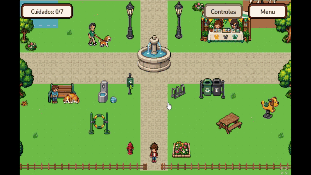
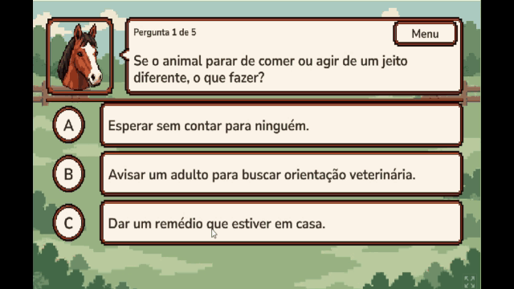

# Pet Educa

GIF: 

**Pet Educa** é um jogo educativo para navegador sobre alimentação e cuidado responsável com os animais. O projeto foi desenvolvido por Laíssa Dornelles Salles em colaboração com o **FeevalePet**, da Universidade Feevale, usando JavaScript e Phaser.

## Minigames

### Jogo da Alimentação

Ajude o Caramelo a pegar alimentos adequados e desviar dos que fazem mal. Você tem 60 segundos para somar pontos.

### Passeio Consciente

Explore a praça, converse com os personagens e descubra sete cuidados importantes para os animais.

GIF: 

### Quiz do Saci

Responda cinco perguntas sorteadas de um banco de 15 e receba feedback a cada resposta.

GIF: 

## Desenvolvimento

Consulte o [guia de desenvolvimento](docs/desenvolvimento.md) para ver os controles, rodar o projeto, executar os testes e gerar o build. O guia também descreve a estrutura do código, as ferramentas de desenvolvimento e os créditos e licenças.
